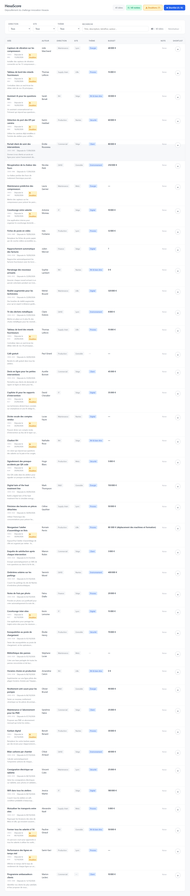
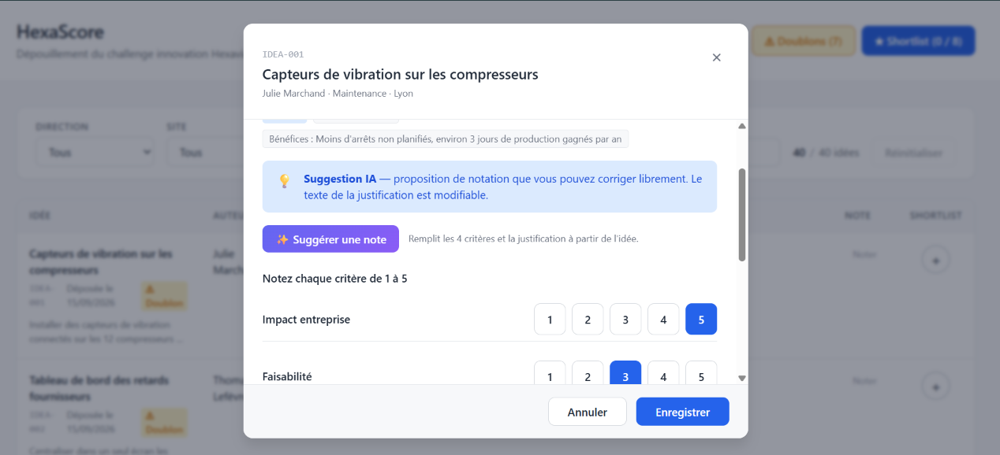
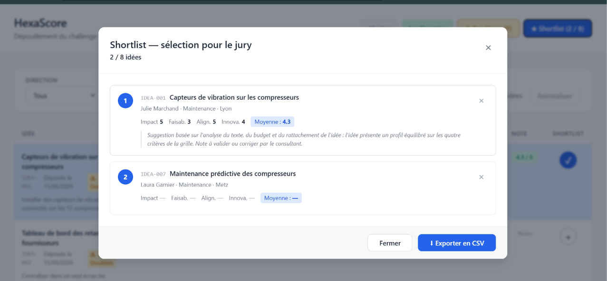

# HexaScore

[](https://github.com/YassineBahadi/hexascore/actions)

Outil de dépouillement du challenge innovation Hexavia, pour les consultants INSKIP.

## Aperçu

**Application en ligne** : À REMPLACER — `https://hexascore-xxx.vercel.app`



*Tableau des 40 idées avec filtres, notes, badge doublon et bouton shortlist.*



*Panneau de notation sur les 4 critères de la grille client, avec suggestion IA modifiable.*



*Shortlist triée par moyenne, prête à exporter pour le jury.*

## Lancer l'outil

```bash
git clone https://github.com/YassineBahadi/hexascore.git
cd hexascore
npm install
npm run dev
# → http://localhost:5173
```

Autres commandes :

```bash
npm test            # 61 tests Vitest
npm run test:coverage
npm run build       # build production
npm run preview     # preview du build
```

Aucune variable d'environnement requise. Voir `.env.example` pour les secrets futurs.

## 1. Cadrage

**Le besoin de Camille en 5 lignes :**

Camille dépouille à la main 40 idées dans Excel pour le challenge Hexavia. Elle perd du temps et n'arrive pas à noter de façon cohérente d'une idée à l'autre. Il lui faut un outil qui centralise les idées, permet de filtrer, noter sur 4 critères (impact, faisabilité, alignement, innovation, 1-5), détecter les doublons, et exporter une shortlist d'environ 8 idées. Elle n'est pas technique.

**Qui utilise :**

- Camille (consultante INSKIP, non technique) — utilisatrice principale
- Ses collègues consultants — réutiliseront l'outil sur d'autres challenges (V1.5)
- Le jury Hexavia — reçoit la shortlist finale en CSV

**Hypothèses posées :**

- Un seul challenge à la fois en V1 (Hexavia)
- Pas d'authentification en V1 — usage solo, données locales au navigateur
- IA simulée en V1 (déterministe, sans clé API) ; clé branchable via configuration
- UI en français
- Données imparfaites assumées (budgets manquants, thèmes vides, dates hétérogènes) → affichage tolérant
- Shortlist exportée en CSV en V1 (pas de PDF stylé)
- Persistance locale (localStorage) en V1 → migration Supabase en V1.5

**Périmètre V1 (livré) :**

- Affichage + filtres + recherche (direction, site, thème, texte, insensible aux accents)
- Notation manuelle 4 critères (1-5) + justification
- Suggestion IA déterministe + justification éditable
- Détection de doublons (5 groupes réels détectés sur les 40 idées)
- Shortlist + export CSV
- Persistance automatique au navigateur
- 61 tests + CI

**Hors V1 (assumé, documenté) :**

- Multi-challenge
- Authentification / multi-utilisateurs
- Vrai modèle IA branché (clé API prête, non utilisée)
- Export PDF stylé
- Édition du CSV depuis l'UI

## 2. Conception

**Architecture** — SPA 100 % côté client, déployée sur Vercel.

```text
┌─────────────────────────────────────────┐
│         Navigateur de Camille           │
│  ┌───────────────┐   ┌───────────────┐  │
│  │  React (UI)   │   │  localStorage │  │
│  │               │◄──┤   (scores,    │  │
│  │  Composants   │   │   shortlist)  │  │
│  └───────┬───────┘   └───────────────┘  │
│  ┌───────▼───────┐   ┌───────────────┐  │
│  │  lib/         │   │  data/        │  │
│  │  (logique)    │◄──┤  CSV statique │  │
│  └───────────────┘   └───────────────┘  │
└─────────────────────────────────────────┘
```

**Modèle de données :**

```typescript
interface Idea {                    // Immuable, issue du CSV
  id, dateDepot, prenom, nom, direction, site, theme,
  titre, description, beneficesAttendus, budgetEstime  // budgetEstime : string brut
}

interface Score {                   // Mutable, saisie de Camille
  ideaId, impact, faisabilite, alignement, innovation  // 1-5 ou null
  justification, suggestedByAi, updatedAt
}

interface DuplicateGroup {          // Calculé, non persisté
  id, ideaIds[], confidence, reason
}
```

**Stack et justifications :**

| Choix | Raison |
|---|---|
| Vite + React + TypeScript | Aligné sur INSKIP. Vite = build rapide, config minimale. TS strict = filet de sécurité |
| CSS pur avec variables | Pas de Tailwind pour maîtriser ce qu'on écrit. Variables = thème centralisé |
| papaparse | Standard pour CSV. Gère séparateur `;` et cellules multi-lignes |
| localStorage (via `src/storage/`) | Zéro backend, zéro secret. Abstrait derrière une interface pour brancher Supabase en V1.5 sans toucher à l'UI |
| Vitest | Livré avec Vite, même config, rapide |
| GitHub Actions | CI gratuite, alignée brief |
| Vercel | Déploiement en 1 clic, free tier, URL publique HTTPS |

**Ce qu'on n'utilise pas :** Next.js (sur-ingénierie pour SPA simple), Supabase (V1.5), Tailwind (apprentissage CSS), Redux (state local suffit).

## 3. Construction avec l'IA

**Outil utilisé :** Claude Code (ou équivalent) dans le dossier `hexascore/`, avec `CLAUDE.md` comme contrat.

**Ma démarche :** coder à la main les modules métier critiques (formatters, filters, scores, duplicates, shortlist, export), puis utiliser l'IA de façon critique pour challenger et détecter mes angles morts. L'IA apporte l'architecture et les cas limites ; moi j'apporte le métier.

### Les 3 prompts les plus utiles

**Prompt 1 — Cadrer l'assistant pour toute la session**

> « Lis CLAUDE.md. Le projet est HexaScore, un outil de dépouillement d'idées pour une consultante non technique. Je veux coder chaque module à la main pour maîtriser la logique, mais tu interviens en reviewer : tu identifies les cas limites que j'ai manqués, tu proposes des tests, tu signales les anti-patterns. Pas de dépendance externe. »

**Prompt 2 — Challenger la détection de doublons**

> « Voici mon src/lib/duplicates.ts. J'utilise Jaccard sur titres + descriptions avec pondération 0.6/0.4. Sur les 40 idées du CSV, je détecte 1 groupe (IDEA-002/014, titres identiques) mais je rate IDEA-003/019 ("Assistant IA RH" vs "Chatbot RH") et IDEA-017/018 ("Copilote IA rapports" vs "Dictée vocale comptes rendus"). Diagnostique et propose une approche sans dépendance externe. »

**Prompt 3 — Détecter les tests manquants**

> « Voici mes 6 fichiers de tests. Regarde src/lib/ et dis-moi : quels cas limites ne sont pas couverts ? Quels tests sont redondants ? Quels tests testent l'implémentation plutôt que le comportement ? »

### Un moment où l'IA s'est trompée

**Prompt envoyé :**

> « Génère duplicates.ts : détecte les idées en doublon. Pas de dépendance externe, TypeScript strict. »

**Ce que l'IA a produit :** un code structurellement excellent — Dice coefficient pondéré (0.6 titre / 0.4 description), gestion propre des champs vides (`null` au lieu de 0), composantes connexes pour la transitivité, IDs stables pour les keys React. Sur la forme, meilleur que ma version manuelle.

**Comment je m'en suis rendu compte :** en testant sur les 40 idées réelles du CSV (pas sur des fixtures inventées). Le code ne détecte qu'1 groupe sur 5. La paire IDEA-017/018 obtient un score de 0.05 — zéro token commun dans les titres, un seul dans les descriptions.

**Le diagnostic :** aucune similarité lexicale (Dice, Jaccard, TF-IDF) ne peut détecter une paraphrase métier. « Chatbot » et « assistant IA » ne partagent aucun token, mais décrivent la même fonctionnalité dans une entreprise. « Dicter un rapport » et « IA qui rédige un rapport » non plus.

**La correction :** ajout d'une couche `CONCEPTS` — un dictionnaire de synonymes métier (ia, rh, covoiturage, capteurs, predictive, energie, securite, reporting, dictee). Score final = `max(scoreLexical, scoreSémantique)`. 5 lignes modifiées dans la boucle principale, 4 groupes récupérés, zéro faux positif.

**Second exemple (patch incomplet) :** quand j'ai demandé à l'IA d'intégrer le badge doublon dans `IdeaTable.tsx`, elle a déclaré la prop `duplicateGroups` dans l'interface mais ne l'a jamais utilisée dans le rendu. Le code compilait (la prop acceptée n'était pas consommée), aucun badge ne s'affichait. Je m'en suis rendu compte en lançant l'app, puis un `grep duplicateGroups` a confirmé : 1 seule occurrence dans l'interface, rien dans le JSX. Leçon : après chaque patch IA, vérifier que la prop ajoutée est effectivement consommée en aval.

**Ce que j'en retiens :**

- L'IA excelle sur l'architecture, les cas limites, la structure.
- L'IA ne connaît pas le métier — c'est au développeur d'apporter la couche domaine.
- Un patch IA peut être partiellement appliqué — toujours tester le comportement, pas juste `npm run build`.

## 4. Fiabilisation

### Ce qui est testé et pourquoi

La logique métier est isolée dans `src/lib/` et testée avec Vitest (61 tests, 6 fichiers). L'objectif n'est pas la couverture à 100 %, mais de figer les comportements qui comptent :

| Module | Tests | Ce qu'on protège |
|---|---|---|
| formatters | 17 | Parsing des dates hétérogènes (ISO + FR) et des budgets libres ("40 000 €", "15k", "?", vide) |
| filters | 15 | Recherche insensible aux accents, sentinelle `__empty__`, combinaisons AND |
| scores | 13 | Moyenne calculée sur les critères notés seulement, distinction vide/partiel/complet |
| duplicates | 7 | Les vrais doublons du CSV : 002/014 (titre identique), 003/019 (assistant IA RH ~ chatbot RH), 017/018 (dictée vocale ~ copilote IA), transitivité, absence de faux positifs |
| shortlist | 4 | Tri par moyenne décroissante, nulls en fin, IDs orphelins ignorés |
| exportCsv | 5 | BOM UTF-8, séparateur `;`, échappement RFC 4180 des `"` et `;` |
| **Total** | **61** | |

**Ce qui n'est pas testé (assumé) :**

- Composants React (ScorePanel, DuplicatePanel, ShortlistPanel) : testés manuellement via QA, ajout de `@testing-library/react` en V1.5
- `src/storage/` : nécessite jsdom, déprioritisé en V1
- `aiSimulation` : déterministe et sans état, ses sorties sont validées par les tests d'intégration manuels

### La CI

`.github/workflows/ci.yml` lance à chaque `push` et `pull_request` sur `main` :

1. `npm ci` — installation reproductible
2. `npm test` — les 61 tests
3. `npm run build` — TypeScript strict + build Vite

**Statut :** CI verte (voir badge en haut du README).

### Limites connues

- Pas de test sur le rendu visuel — un composant peut régresser sans que la CI le voie
- Pas de test E2E (Playwright) — hors budget temps de la V1
- L'export CSV utilise `;` (Excel FR). Un utilisateur sur Excel EN verra une seule colonne. Remède : ouvrir via « Données > À partir d'un fichier texte » avec séparateur `;`. Documenté en section 5.

## 5. Livraison

**Application en ligne :** À REMPLACER — `https://hexascore.vercel.app/`

**Configuration requise :** aucune. Aucune variable d'environnement, aucun secret.

**Ce qui manque avant de confier à Camille en production :**

1. **Authentification** — actuellement, quiconque a l'URL peut noter. En V1.5, ajouter un login (SSO INSKIP ou magic-link)
2. **Migration Supabase** — pour partager les notes entre navigateurs et faire du multi-utilisateur. `src/storage/index.ts` est prêt à être réécrit
3. **Vrai modèle IA** — la simulation est crédible mais reste heuristique. Brancher OpenAI/Anthropic via proxy backend (jamais en clé front)
4. **Support CSV EN** — détecter la locale ou proposer un séparateur au choix
5. **Test sur mobile** — l'app est utilisable sur mobile, pas optimale

**Dette technique documentée :**

- `role="button"` sur un `<tr>` avec un `<button>` imbriqué : compromis ARIA pragmatique, fonctionne avec les lecteurs d'écran, non strictement idéal
- `parseBudgetSafe` duplique `parseBudget` dans `aiSimulation.ts` : isolation volontaire, 15 lignes dupliquées

## 6. Journal

**J+0 (nov. 2026, ~4h de travail effectif)**

- Cadrage, conception, setup projet Vite + React + TS
- Parsing CSV robuste (dates hétérogènes, budgets libres)
- Tableau des 40 idées avec badges
- Filtres (direction, site, thème, recherche insensible aux accents)
- Notation manuelle sur grille 4 critères + persistance localStorage
- Suggestion IA déterministe + justification éditable
- Détection de doublons (patch IA après diagnostic manuel)
- Shortlist + export CSV RFC 4180
- 61 tests Vitest + CI GitHub Actions
- Déploiement Vercel + README

## 7. Suite et questions pour Camille

**Avec une journée de plus :**

1. Brancher un vrai modèle IA (via proxy backend, jamais en clé front)
2. Ajouter l'authentification (SSO INSKIP)
3. Migrer la persistance de localStorage vers Supabase (le code `src/storage/` est prêt)
4. Ajouter un export PDF stylé pour la shortlist (avec logo INSKIP, mise en page)
5. Vue « multi-challenge » pour réutiliser l'outil sur d'autres clients
6. Mode comparaison côte à côte de deux idées (utile pour les débats de jury)

**Questions pour Camille :**

1. **Format d'envoi au client :** le CSV brut est-il le format attendu, ou faut-il un PDF plus habillé ?
2. **Partage entre consultants :** ses collègues vont-ils vouloir noter les mêmes idées ? Si oui, on part sur Supabase + auth tout de suite.
3. **Édition du CSV :** si une idée est mal saisie, faut-il pouvoir la corriger dans l'outil, ou est-ce qu'on réimporte un CSV corrigé ?
4. **Critères du jury :** les 4 critères actuels sont-ils stables, ou le client va-t-il en changer au fil des challenges ? (impact sur le modèle de données)
5. **Visibilité des notes IA :** dans la shortlist envoyée au client, faut-il garder le flag « suggestion IA » ou est-ce transparent ?
6. **Volume maximal :** 40 idées est confortable. Si un challenge a 200 idées, on garde la même approche ou on ajoute une pré-notation automatique en batch ?
7. **Authentification :** y a-t-il un SSO INSKIP à privilégier, ou un simple magic-link suffit ?